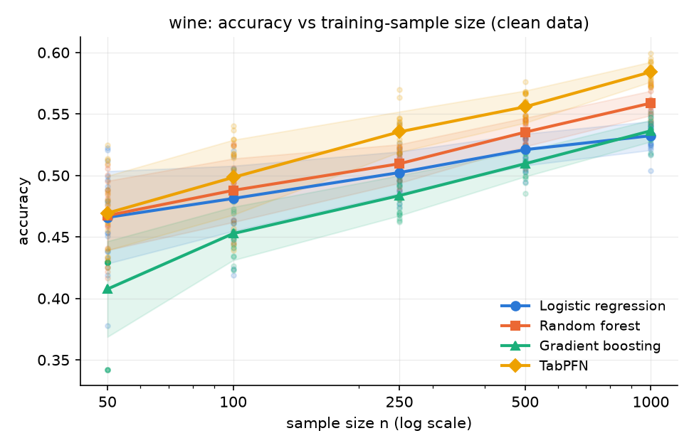
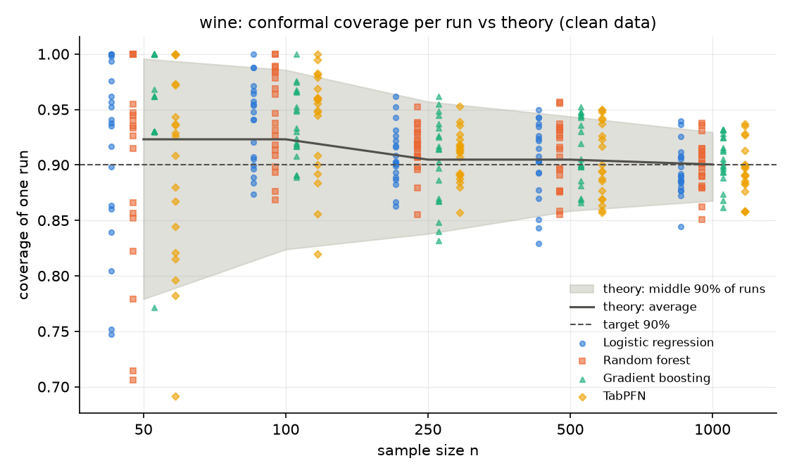
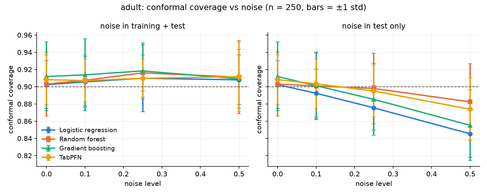

# Small, noisy tabular data: a benchmark of TabPFN vs classic models, with an empirical check of conformal-prediction theory

**Type:** benchmark and empirical analysis (not a new method).
**Date:** 2026-10-28. **Code and data pipeline:** this repository.

## 1. Question

Many real tables are small (tens to hundreds of rows) and noisy (imprecise measurements).
We ask three questions:

1. **Accuracy.** With 50–1,000 training rows, does TabPFN (a neural network pre-trained on
   millions of synthetic tables) beat logistic regression, random forest and gradient boosting?
2. **Stability.** How much do results swing just from which small sample was drawn?
3. **Trust.** Split conformal prediction (a method that turns any model's output into a *set*
   of classes that should contain the true class at least 90% of the time) has a known
   finite-sample theory. Does that theory hold on real, small, noisy data, and what happens
   when the noise appears only at test time?

Before the full results were seen, we wrote down numerical predictions for question 3
([`predictions.md`](predictions.md), written 19:05–19:15 IST on 2026-10-28). Honest timing note: the
file was first committed to git at 20:18 IST, when a partial classic-model run already existed;
its content was not changed after 19:15. It is therefore a written-in-advance plan, not a formal
pre-registration (a public, time-stamped plan made before any data is collected).

## 2. Data

| Dataset | Rows | Task | Notes |
|---|---|---|---|
| Wine Quality (Cortez et al., 2009) | 6,497 | 5 ordered quality classes | red + white combined, with a colour column; rare scores 3 and 9 merged into 4 and 8 |
| Adult Income (Becker & Kohavi, 1996) | 48,842 | income >50K (24%) vs ≤50K (76%) | `fnlwgt` and text `education` dropped; `?` kept as "Unknown" |

## 3. Method

- **Reference test set:** 2,000 fixed rows per dataset. Every run is scored on these rows.
- **Small samples:** n = 50, 100, 250, 500, 1000 rows drawn from the rest, **20 repeats** each.
  Each sample is split 75% for training and 25% for **calibration** (rows used only to set the
  conformal cut-off). So at n = 50 the model trains on 38 rows.
- **Models:** default settings, no tuning. TabPFN v9.2.0 (TabPFN-3.5 weights), scikit-learn 1.9.1.
  TabPFN ran on a Colab T4 GPU and the others on a CPU. Results are identical across machines
  because every random draw comes from a fixed **seed** (starting number for the random generator).
- **Noise:** numeric columns get **Gaussian noise** (bell-curve jitter) of size level × that
  column's spread; categorical values are replaced at random with probability = level.
  Levels: 0, 0.1, 0.25, 0.5. There are two settings:
  - **both:** noise in training, calibration and test alike, so the conformal guarantee should still hold
  - **test_only:** clean training and calibration, noisy test data. This is a **distribution shift**
    (new data differs from training data), so the guarantee can fail.
- **Fairness:** in each repeat, all four models see the same sample and the same noise.
- **Metrics:**
  - accuracy, and **balanced accuracy** (accuracy averaged per class)
  - **log loss** (penalty for confident wrong answers)
  - **ECE**, expected calibration error (gap between stated confidence and actual accuracy)
  - for Wine, **MAE** (mean absolute error, average distance from the true quality score)
  - conformal **coverage** (share of sets containing the true class) and **set size**
- **Statistics:** TabPFN vs the best classic model is compared per repeat with a **Wilcoxon
  signed-rank test** (a check of whether paired differences are consistent or just luck).

In total: 4 models × 2 datasets × 5 sizes × 20 repeats = 800 runs, each evaluated in 7 noise
conditions, giving 5,600 result rows.

## 4. Results

### 4.1 Accuracy: TabPFN wins from n = 250 upwards, by modest margins, and not at n = 50

Clean-data accuracy, mean over 20 repeats:

| n | 50 | 100 | 250 | 500 | 1000 |
|---|---|---|---|---|---|
| Wine: TabPFN | 0.469 | 0.498 | 0.535 | 0.556 | 0.584 |
| Wine: best classic (random forest) | 0.467 | 0.488 | 0.510 | 0.535 | 0.559 |
| Adult: TabPFN | 0.786 | 0.817 | 0.837 | 0.849 | 0.855 |
| Adult: best classic (logistic regression) | 0.795 | 0.819 | 0.831 | 0.841 | 0.844 |

Paired comparison of TabPFN against the best classic model:
- **Wine:** TabPFN wins 19–20 of 20 repeats at n ≥ 250 (p ≤ 0.0001). At n = 50 there is
  no difference (12/20, p = 0.46).
- **Adult:** TabPFN wins 16–19 of 20 at n ≥ 250 (p ≤ 0.002). At n = 50 it is slightly *worse*
  than logistic regression (−0.9 points, wins 5/20, p = 0.012).

This matches a recent report that TabPFN's accuracy edge needs enough in-context examples and
can reverse at very few samples (Zhang et al., 2026). With our 25% calibration split, n = 50
means only 38 training rows.

Wine is hard for every model: the best balanced accuracy is 0.37, at n = 1000 with TabPFN.

### 4.2 Probabilities and answer sets: TabPFN is best almost everywhere

- **Log loss:** TabPFN has the lowest log loss in all 10 dataset/size cases (at Adult n = 50
  only just: 0.448 vs 0.450 for random forest).
- **Set size:** TabPFN gives the smallest 90% answer sets on Wine at every n (2.09 classes at
  n = 1000, vs 2.24–2.43 for the others), and the smallest or near-smallest sets on Adult.
- **Gradient boosting is badly calibrated on Wine:** ECE is about 0.3 for n ≥ 100, against
  0.02–0.03 for the other models at n = 1000.
- **Majority-class guessing:** on Adult at n = 50, gradient boosting predicts "≤50K" for
  everyone (accuracy 0.762, balanced accuracy exactly 0.50).

### 4.3 Conformal theory on real data: confirmed, once enough repeats are used

How the predictions written in advance ([`predictions.md`](predictions.md)) turned out:

| Prediction | Outcome |
|---|---|
| **P1** average coverage matches theory (clean and "both" noise) | **Supported.** Clean data: 38 of 40 model/dataset/size cases within 2 standard errors. The clear exception is gradient boosting on Adult at n = 50 (97.6%), caused by its constant predictions, where all scores tie. |
| **P2** run-to-run spread matches the Beta-distribution theory | **Supported, with a lesson.** With 20 repeats the measured spread looked about 20% too large at n = 1000 for every model. A follow-up with **200 repeats** (logistic regression, n = 250 and 1000; `results/tables/check_lr_200_repeats.csv`) gives ratios of 0.86–0.99 against theory adjusted for the 2,000-row test set. The 20-repeat excess was sampling noise. It looked "consistent across models" only because all models share the same calibration rows in each repeat, so their swings are correlated: one coincidence counted four times. |
| **P3** coverage is model-independent; better models give smaller sets | **Supported.** Coverage behaves the same for all models; TabPFN, with the best probabilities, has the smallest sets. |
| **P4** "both" noise keeps the guarantee; sets grow | **Supported.** Coverage stays near theory (112 of 120 cases within 2 standard errors) and sets grow with noise, e.g. Adult n = 250: 1.17 → 1.29 classes for TabPFN. |
| **P5** test-only noise lowers coverage | **Partly supported.** True on Adult for every model, and on Wine for logistic regression. **Not** true for random forest on Wine (coverage stays at 90–92%), and TabPFN on Wine drops only slightly. |
| **P6** random forest ties push its coverage above theory | **Not supported.** Random forest coverage is not systematically above theory. |
| **P7** sets are too large to be useful at n = 50 | **Supported.** Wine: 3.2–3.8 of 5 classes. Adult: 1.3–1.9 of 2 classes. |
| **P8** TabPFN: smallest sets? more robust to test-time noise? | Smallest sets: **yes**. Robustness: **depends on the dataset** (see 4.4). |

### 4.4 When noise appears only at test time, robustness depends on model and dataset

At n = 1000, highest noise level (0.5), test-only:

| | Logistic regression | Gradient boosting | Random forest | TabPFN |
|---|---|---|---|---|
| Adult coverage | 0.837 | 0.824 | 0.874 | 0.840 |
| Adult: share of runs below 85% | 85% | 90% | 10% | 65% |
| Wine coverage | 0.854 | 0.890 | 0.899 | 0.876 |

The models that kept coverage did so by **enlarging their sets** when inputs became noisy.
Random forest on Wine went from 2.24 to 2.47 classes per set. Logistic regression kept the same
set size (2.31 → 2.29) while becoming more often wrong; this is **overconfidence under shift**
(staying just as sure while getting worse). TabPFN behaves like random forest on Wine and like
logistic regression on Adult. With two datasets we cannot say why; it is a question for
further work.

Accuracy itself degrades similarly for all models under noise. TabPFN keeps, but does not widen,
its lead (e.g. Wine n = 250, "both" noise 0.5: 0.492 vs 0.476 for random forest).

## 5. What is new here, and what is not

Each ingredient is established:
- TabPFN is strong on small tables (Hollmann et al., 2025).
- Split conformal prediction guarantees average coverage under exchangeability, and one run's
  coverage follows a Beta distribution set only by the calibration size
  (Vovk, 2012; Angelopoulos & Bates, 2023; Marques F., 2023).
- Distribution shift breaks the guarantee (Tibshirani et al., 2019).

What this project adds is modest, and should be described that way:
1. an **empirical check, with predictions written in advance,** of the finite-sample coverage theory on real, small,
   noisy tables across four model families, including a worked example of how too few
   repeats, plus correlated repeats, can fake a deviation from theory
2. evidence that, under **test-time input noise**, conformal robustness is **model- and
   dataset-dependent**, and that the deciding behaviour is whether a model's sets grow
   when its inputs get noisier
3. an independent confirmation that TabPFN's advantage **disappears at the smallest sizes**
   (38 training rows), while its calibration and set efficiency remain the best

## 6. Limitations

- Two datasets, both widely studied. The findings in 4.4 in particular need more datasets.
- Default settings only; tuned classic models might close the accuracy gap.
- One conformal score (1 − probability of the true class). Other scores (e.g. APS, adaptive
  prediction sets) behave differently.
- The noise is synthetic and uniform across columns. Real measurement error is messier.
- The same 2,000 test rows are reused in every repeat. This adds a shared offset of about
  ±0.7 points to all average coverages, which explains small shared deviations such as all
  models being about 1 point above theory on Adult at n = 500.
- 20 repeats detect large effects only. The 200-repeat check was run for one model.

## 7. Future work

- **Cross-conformal / CV+ methods** (reuse every row for both training and calibration):
  should give smaller sets at small n than our 75/25 split.
- **Many datasets** (e.g. 20–50 small OpenML tables) to test the test-time-noise finding.
- **Shift-aware conformal methods** (e.g. weighted conformal prediction) for the test-only setting.

## 8. Reproducing

See the README. Classic models: `python -m src.experiment --models logistic_regression random_forest gradient_boosting`.
TabPFN: `colab/run_experiments.ipynb`. Analysis: `python -m src.report` and
`python -m src.coverage_theory`. 200-repeat check: `python -m src.experiment --models
logistic_regression --sizes 250 1000 --repeats 200 --noise-levels 0 --out results/tables/check_lr_200_repeats.csv`.

## References

- Angelopoulos, A. N., & Bates, S. (2023). Conformal prediction: A gentle introduction. *Foundations and Trends in Machine Learning*.
- Becker, B., & Kohavi, R. (1996). Adult [Dataset]. UCI Machine Learning Repository.
- Cortez, P., Cerdeira, A., Almeida, F., Matos, T., & Reis, J. (2009). Modeling wine preferences by data mining from physicochemical properties. *Decision Support Systems*. Dataset: UCI Machine Learning Repository.
- Hollmann, N., et al. (2025). Accurate predictions on small data with a tabular foundation model. *Nature*.
- Marques F., P. C. (2023). Universal distribution of the empirical coverage in split conformal prediction. arXiv:2303.02770.
- Tibshirani, R. J., Barber, R. F., Candès, E. J., & Ramdas, A. (2019). Conformal prediction under covariate shift. *NeurIPS*. arXiv:1904.06019.
- Vovk, V. (2012). Conditional validity of inductive conformal predictors. *ACML*.
- Zhang, J., Zhong, L., Zhu, Z., Huang, S., & Xu, Y. (2026). TabPFN beyond tabular data: Calibration and accuracy on multimodal embeddings. arXiv:2607.11007.
